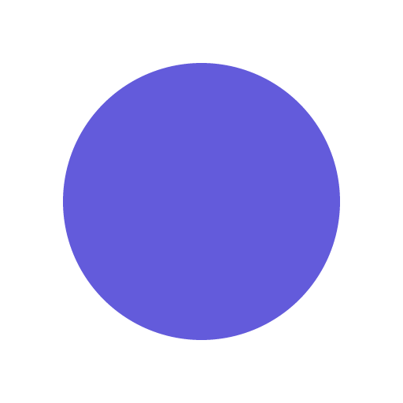
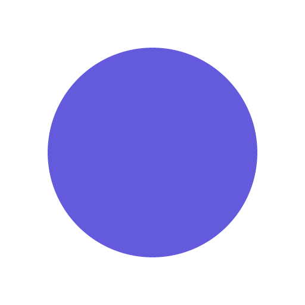
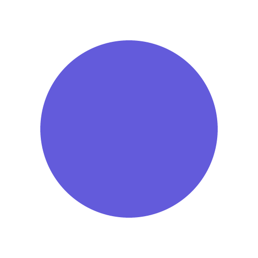

# ファビコン

タブアイコンの変更を拡大して比較（2026-10-12）

## 概要

### 記録について
変更前から現在までを古い順に表示。途中の版（2〜7）は、会話と作業ログに残る色・位置・半径から復元したもので、当時の出力ファイルそのものではない。1は残っていた旧PNG、8の通常色は現在の実ファイル。正本はstatic/favicon-dot.svgとscripts/build-favicons.cjs。背景のチェック柄は透明部分を示す。

## 変更の流れ

### 1〜3. 変更の流れ
  

#### 1. 変更前のプロフィール画像

リポジトリに残っている旧ファビコンを使用。

<!-- embed -->
[見本 1](favicon/見本-1.html)

#### 2. 紫のドット・透明背景

ホームの紫色。中心(32,32)、半径22。

<!-- embed -->
[見本 2](favicon/見本-2.html)

#### 3. 白い四角の背景

紫の大きさと位置はそのまま、白背景を追加。

<!-- embed -->
[見本 3](favicon/見本-3.html)

### 4〜6. 変更の流れ
  

#### 4. 白い円の背景

背景を半径31の白い円にし、外側を透明にした。

<!-- embed -->
[見本 4](favicon/見本-4.html)

#### 5. 紫のドットを縮小

紫の半径を22から16へ。

<!-- embed -->
[見本 5](favicon/見本-5.html)

#### 6. 左上の紫＋手前のオレンジ

紫の中心(27,27)。オレンジの中心(41,41)、半径9。

<!-- embed -->
[見本 6](favicon/見本-6.html)

### 7〜8. 変更の流れ
 

#### 7. オレンジを拡大

オレンジの半径を9から11へ。

<!-- embed -->
[見本 7](favicon/見本-7.html)

#### 8. オレンジに白い縁取り（現在）

半径11のオレンジの外側に2pxの白い縁取り。

<!-- embed -->
[見本 8](favicon/見本-8.html)

## 現在の版

### 現在の版を大きく確認
左は通常色、右はダーク設定の色。512pxの画像を大きく表示する。

<!-- embed -->
[見本 9](favicon/見本-9.html)

通常色のタブサイズ

<!-- embed -->
[見本 10](favicon/見本-10.html)

ダーク設定のタブサイズ

<!-- embed -->
[見本 11](favicon/見本-11.html)

## オレンジの大きさ

### オレンジをもう少し大きく
オレンジの半径を11から13へ約18%拡大。白い縁取りは2px、紫・白背景・位置は保持。左が変更前の8、右が新しい9。通常色の画像は実ファイルの保存版。

 

9の実際のタブサイズ

<!-- embed -->
[見本 12](favicon/見本-12.html)

## 採用版

### 第8版に戻す
ユーザーの指示で、第9版の拡大を取り消し、第8版に戻した。オレンジの半径は11、白い縁取りは2px。第9版は比較の記録として保持する。

<!-- embed -->
[見本 13](favicon/見本-13.html)
