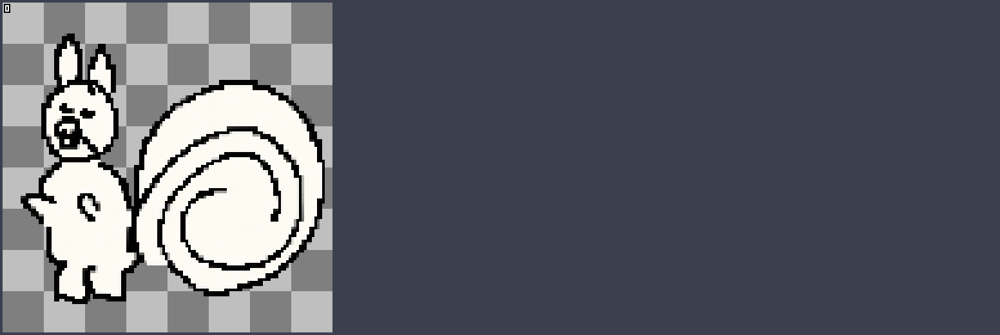
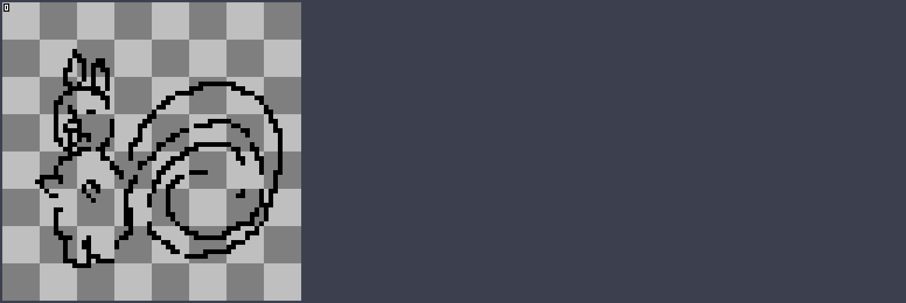
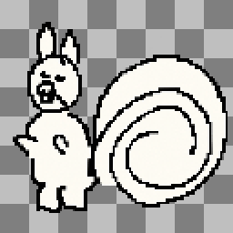
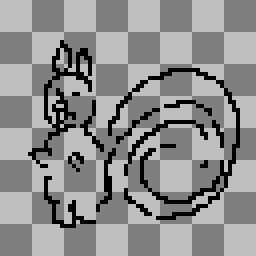

# プロフィール画像のドット絵

元のリスを128×128のドット絵にする（2026-10-12）

## プロフィールのドット絵

### プロフィール画像のドット絵
- **変更** : 元の手描きのリスを参考に、imagegen で1枚生成。素朴な表情、長い耳、大きな渦巻きのしっぽ、白黒の配色を保持するよう指定した。背景は透明
- **変更** : 生成出力は 1254×1254px のため、補間なしの最近傍で 128×128px に縮小した
- **素材** : 元画像は `profile_pixel/1-reference.png`、生成出力は `1-generated.png`、説明文は `1-prompt.txt`
- **補足** : ブログにはまだ設置していない

- **素材** : 原寸は `profile_pixel/1.png`(上は4倍で表示)。正本は `assets/img/blog-character/profile-pixel-128-v1.png`
- **課題** : 元の画像をもとにした生成案で、線や細部は元と完全には一致しない

### 64×64・黒のみ・内側も透過
- **依頼** : 64×64 の黒い輪郭のドット絵で、内側も透過
- **変更** : 元のプロフィール画像を参考に imagegen で1枚作り直した。背景・耳・顔・胴体・しっぽの内側を透明にした
- **変更** : 最近傍で 64×64 へ縮小し、RGB を黒のみ、アルファを 0 または 255 に統一した。128px 版はそのまま保持
- **素材** : 生成出力は `profile_pixel/2-generated.png`、説明文は `2-prompt.txt`

- **素材** : 原寸は `profile_pixel/2.png`(上は8倍の表示)。正本は `assets/img/blog-character/profile-pixel-64-v2.png`
- **結果** : 色は黒のみで、白い塗りつぶしはない
- **補足** : ブログにはまだ設置していない

### 128×128版と64×64版の比較
- **補足** : 左が 128×128 版、右が 64×64 版。同じ表示サイズになるよう、左は4倍、右は8倍で拡大。64px 版は黒線のみで内側も透明

 
